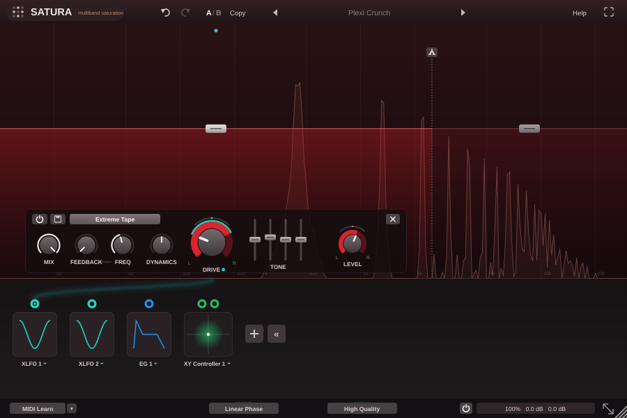
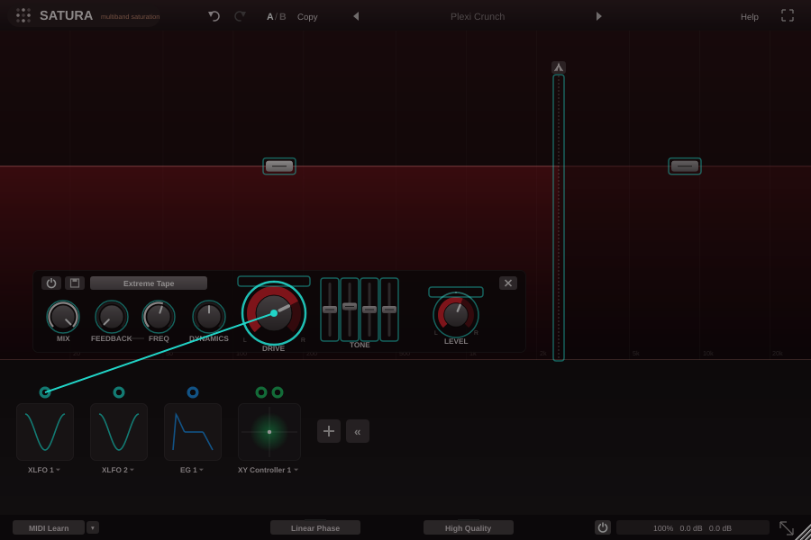

# SATURA (Collateral Effects): distorsione multibanda con modulazione (VST3 / AU / Standalone)

Plugin in C++17 con JUCE 8. Riproduce le funzioni e l'interfaccia di FabFilter Saturn 2 descritte nel suo
manuale: fino a 6 bande, 27 stili di distorsione, feedback, dinamica, tono, e il sistema di modulazione
drag-and-drop con XLFO, Envelope Generator, Envelope Follower, sorgenti MIDI e controller XY/slider.
Nome, grafica e algoritmi sono propri: non contiene codice né marchi FabFilter.



## Funzioni

**Display multibanda.** Il pulsante `+` in alto divide la banda sotto il mouse. Le linee tratteggiate spostano i crossover, e il pulsante al centro di ciascuna sceglie la pendenza (6, 12, 24 o 48 dB/oct). Le maniglie di livello si trascinano in verticale per il livello (con Alt per il Drive) e in orizzontale per spostare entrambi i crossover della banda. Trascinando sullo sfondo si selezionano più bande. S e M fanno solo e mute: tenuti premuti agiscono solo finché si tiene premuto il mouse, con Cmd/Ctrl+clic diventano esclusivi. Sotto il display c'è l'analizzatore di spettro dell'uscita.

**Controlli di banda.** Enabled, preset di banda, Style (menu a categorie), Mix, Feedback e frequenza di feedback, Dynamics (compressione a destra, gate/espansione a sinistra), Drive con anello di pan, tono a 4 bande (Bass, Mid, Treble, Presence), Level con anello di pan, e Remove. Con più bande selezionate, i valori continui cambiano in modo relativo e quelli discreti vengono impostati uguali, come in Saturn 2.

**Stili.**
- Tube: Subtle, Clean, Warm, Juicy, Broken
- Tape: Subtle, Clean, Warm, Extreme
- Saturation: Subtle, Gentle, Heavy
- Amplifier: American Clean, American Crunch, British Crunch, British Lead, Smooth, Crunchy, Screaming
- Transformer: Subtle, Warm, Lush
- FX: Smudge, Breakdown, Foldback, Rectify, Destroy

**Modulazione.** Il `+` aggiunge una sorgente, e il pallino colorato si trascina su qualsiasi controllo: anche crossover, maniglie di livello, punti dell'inviluppo e livelli degli slot, per la modulazione annidata. Sono disponibili 4 XLFO a 16 passi (sync, Offset, Balance, Glide, Phase, Snap a 2 ottave, retrigger MIDI e Legato), 4 EG (ADSR con delay, hold, pendenza delle curve e range), 4 EF (modalità Envelope e Transient), 4 sorgenti MIDI (velocity, nota, pitch bend, mod wheel, aftertouch, CC, con 6 curve) e 6 XY/slider. Gli slot sono 32, con pannello dedicato (livello, inversione, on/off, cambio di sorgente e destinazione), visualizzazione del range di modulazione attorno ai controlli e flusso delle sorgenti. EG ed EF si possono attivare dall'ingresso principale, dal **side chain esterno** (bus dell'host), da una banda o dal MIDI, e hanno il pulsante di audizione.



**Barra inferiore.**
- MIDI Learn: con Enable MIDI, Clear, Revert e Save; la mappatura è globale e si salva alla chiusura.
- Linear Phase: crossover e oversampling a fase lineare, con latenza dichiarata all'host.
- High Quality: Off, Good (8×) o Superb (32×).
- Bypass globale morbido, allineato alla latenza.
- Pannello di uscita: Input e Output con pan (Alt li collega in senso opposto), Mix, Unrestricted Feedback e M/S.
- Resize: Small, Medium, Large ed Extra Large, più Scaling.
- Schermo intero.

**In alto.** Undo/redo, A/B con Copy, e il menu dei preset con categorie, Save As, Save As Default, Open Other Preset, Change Preset Folder, Restore Factory Presets e MIDI Program Change (la cartella `__Programs` viene numerata per prima). Con il tasto destro sul nome si apre Save. C'è anche Help con una guida rapida.

**Manopole.** Si regolano in verticale o ruotando la freccia, con la rotella, con Shift per la regolazione fine, con Cmd+clic (Ctrl+clic su Windows) per tornare al default e con doppio clic per scrivere il valore: `1k`, `A4`, `C#3+13`, `2x`, `50%`, `250ms`.

## Motore audio

- **Crossover normali**: Linkwitz-Riley IIR (6, 12, 24 e 48 dB/oct) con compensazione di fase. Con le bande inattive la somma è piatta entro 0,0001 dB.
- **Linear Phase**: kernel FIR progettati in frequenza, con convoluzione FFT a partizioni (L e R viaggiano insieme in una sola FFT complessa). Le bande sono differenze di passa-basso, quindi la ricostruzione è perfetta anche quando i crossover sono modulati (i kernel si ricalcolano con dissolvenza). La latenza è di 2304 campioni a 44,1/48 kHz, 4352 a 88,2/96 kHz.
- **Oversampling**: cascata di half-band 2×. In modalità normale sono polifase IIR (8 coefficienti nel primo stadio, nessuna latenza intera); in Linear Phase sono FIR a fase lineare (135 tap nel primo stadio), con 75 o 76 campioni di latenza aggiuntiva compensata. La reiezione delle immagini è sotto i −96 dB. Il ramo asciutto viene allineato in fase, per cui Mix di banda e Mix globale non fanno filtro a pettine.
- **Saturazione**: 10 curve (tanh, tubo asimmetrico, nastro, cubica, trasformatore, ampli a due stadi, tubo rotto, foldback, rettifica, hard clip), più polarizzazione, EQ prima e dopo, cabinet per gli ampli e compensazione automatica del livello al crescere del Drive. Le funzioni FX speciali sono Smudge (ritardo dipendente dal segnale), Breakdown (sottottava) e Destroy (bit e sample-rate reduction).
- **Unrestricted Feedback** spento: il feedback si riduce da solo quando l'ingresso tace.
- Modulazione a blocchi di 8 campioni, rampe sui guadagni, denormali azzerati e tanh veloce (errore massimo 1,4·10⁻⁷).

## Preset

- **Preset di fabbrica**: 22 preset in 10 categorie, copiati alla prima apertura in `~/Documents/Collateral Effects/Presets/SATURA/` (le sottocartelle diventano categorie). Il formato è JSON con estensione `.cep` ed è lo stesso della versione Max for Live: `Open Other Preset` legge anche i `.json` di quella versione.
- **Preset di sezione e Default di sezione**: `~/Library/Application Support/Collateral Effects/SATURA/Component Presets/`.
- **Altri file**: mappatura MIDI Learn e preferenze di dimensione si trovano nella stessa cartella dell'applicazione.

## MIDI

In Logic SATURA è un **AU MIDI-controlled Effect**, come Saturn 2: nello slot Instrument scegli *AU MIDI-controlled Effects → Collateral Effects → SATURA* e assegna l'audio dal menu Side Chain del plugin. In Live crea una traccia MIDI e mandala alla traccia con SATURA. Serve per le sorgenti MIDI, l'attivazione degli EG, il retrigger delle XLFO, il MIDI Learn e il Program Change.

## Compilazione

GitHub Actions (`.github/workflows/build-macos.yml`) compila a ogni push una build universale (Apple Silicon e Intel) con VST3, AU e Standalone. Esegue i test del motore e `auval`, firma ad-hoc e pubblica lo zip come artefatto; con un tag `v*` crea una release. Nello zip c'è `Installa SATURA.command`, che copia i plugin in `/Library/Audio/Plug-Ins` e rimuove la quarantena.

In locale:

```
cmake -B build -DCMAKE_BUILD_TYPE=Release
cmake --build build --config Release
```

## Test

| Test | Cosa verifica |
|---|---|
| `os_test` | Oversampler IIR e FIR: risposta piatta fino a 20 kHz, immagini sotto i −96 dB, fase lineare e latenza |
| `lp_test` | Splitter a fase lineare: somma uguale a un impulso (errore ~10⁻¹⁶) con 2, 4 o 6 bande e tutte le pendenze, nessuno scatto modulando il crossover |
| `engine_test` | Motore completo: ricostruzione, tutti gli stili, aliasing, XLFO, EG, EF, side chain, MIDI, feedback, bypass, solo, M/S, mix allineato in fase, dinamica, mono |
| `processor_test` | Plugin completo (opzione `SATURA_BUILD_DEVTOOLS`): bus, latenza dichiarata, preset, stato, Program Change, MIDI Learn, undo/A-B, scenario dell'interfaccia e fuzz di 4000 eventi |
| `gui_snapshot` | Salva un'immagine dell'interfaccia; con `gui_snapshot resources/icon.png` rigenera l'icona |

Il VST3 supera anche `pluginval` al livello di severità 8.

## Origine

Il progetto nasce dalla versione Max for Live di SATURA. La specifica condivisa (parametri, stili, sorgenti e preset) si genera con `tools/gen_spec_h.py` dagli stessi file Python di quella versione, e i filtri di oversampling sono progettati in `tools/design_os.py`.
